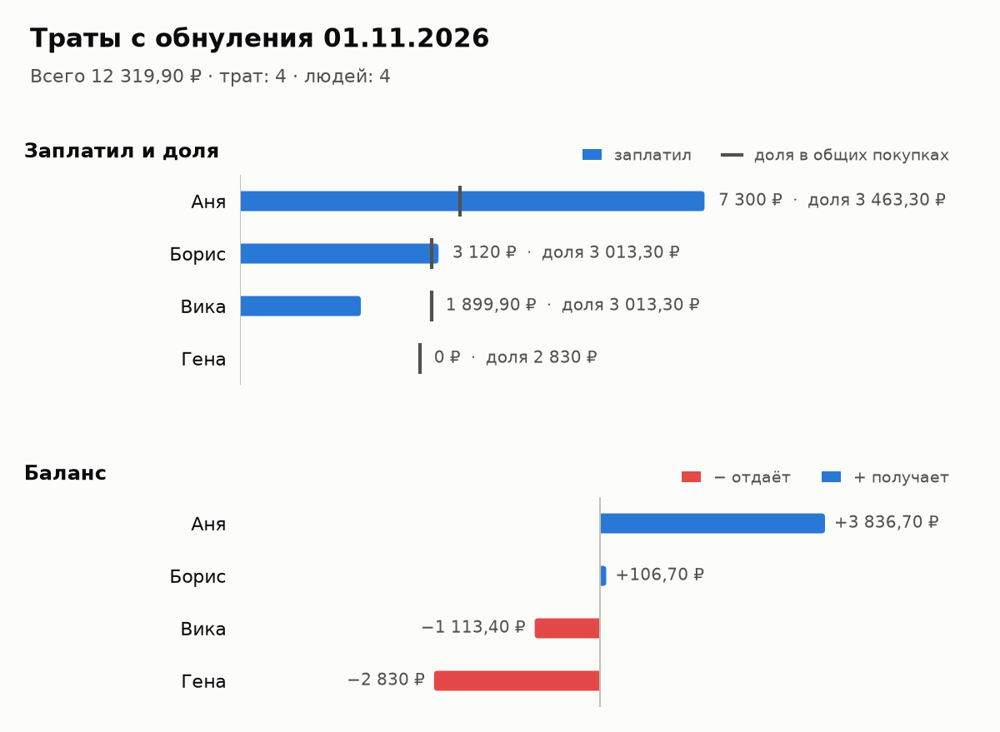
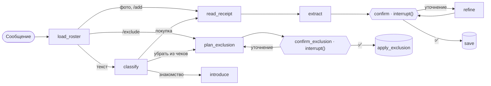

<div align="center">

# 🏠 kaznabot

**Telegram-бот для быта в квартире с соседями: общие траты по чекам, долги, дежурства и ужины**

[](https://github.com/whatarefuck/kaznabot/actions/workflows/ci.yml)


</div>

Скидываете в чат фото чека, бот разбирает позиции через GigaChat и показывает черновик: что купили, на кого делится каждая позиция, какая выходит доля. Нажимаете «✅ Внести», и бот пересчитывает, кто кому сколько переводит. Заодно напоминает о воскресной уборке и собирает график ужинов на неделю.

<p align="center"></p>

## ✨ Что умеет

### 🧾 Траты по чекам
- **Фото или PDF чека**, а можно текстом: `/add хлеб 80, молоко 2 по 60`.
- **Указания обычными словами:** «всё, кроме творога», «пиво только мне и Саше», «весь чек на меня и Лёшу», «Петя заплатил», «вчера».
- **Черновик перед записью.** Чтобы поправить, ответьте на него: «убери пакет», «молоко было 95». Подтвердить или отменить может только автор.
- **Знакомство:** «@nick — Саша, а @nick2 — Лёша». Бот запоминает имена и добавляет людей в расчёт.

### 💸 Кто кому должен
- **`/debts`** — минимальный набор переводов: каждая позиция делится поровну между теми, кому она предназначена.
- **`/chart`** — то же картинкой (пример выше), **`/spent`** — список трат.
- **`/exclude Арслан с 12 по 18 октября`** — убрать человека из общих чеков за дни, когда его не было. Его доля поровну перейдёт остальным, а отменить можно одной кнопкой.
- **`/reset`** — обнулить долги, когда все рассчитались. История при этом сохраняется.

### 🧹 Дежурства по уборке
- **Ротация зон по воскресеньям:** каждую неделю зона переходит к следующему по списку.
- **Напоминание в субботу вечером** с упоминанием каждого: кто что убирает завтра.
- **`/duty`** — таблица на ближайшие недели, **`/duty set 08.11 Данил — Кух, Искандар — В, …`** — задать или поменять ротацию.

### 🍽 Кто когда готовит ужин
- **Опрос в субботу в 12:00:** каждый отмечает дни, когда сможет готовить.
- **График сразу, как проголосуют все,** или в понедельник в 13:00. Бот следит, чтобы нагрузка была ровной: сначала каждому по одному дню, потом вторые дни.
- **Передумали — переголосуйте:** бот пришлёт новый график, остальных по возможности не сдвигая.

### 👥 Несколько квартир
Бота можно добавить в любое количество групп, у каждой свой учёт. Если группа станет супергруппой и Telegram сменит её id, бот перенесёт все данные сам.

## 💬 Команды

| Команда | Что делает |
|---|---|
| `/add …` | Добавить трату текстом. Ответ `/add` на фото чека разбирает это фото |
| `/debts` · `/chart` · `/spent` | Долги, график, список трат (`month` — с 1-го числа, `all` — за всё время) |
| `/exclude …` | Убрать человека из чеков за период |
| `/delete` · `/reset` | Удалить чек · обнулить долги |
| `/duty` · `/duty set …` · `/duty on\|off` | Дежурства: график, ротация, напоминания |
| `/dinner` · `/dinner poll` · `/dinner on\|off` | Ужины: график, опрос прямо сейчас, опрос по субботам |
| `/people` · `/join` · `/leave` | Кто участвует в расчёте |

Privacy mode в [@BotFather](https://t.me/BotFather) можно не выключать. Тогда бот видит в группе только команды и ответы на свои сообщения и не тратит GigaChat на чужие картинки, а чек отправляется ответом `/add` на фото.

## 🧠 Как устроено



- **LangGraph отвечает за логику, aiogram — за Telegram.** Узлы графа ([ai/graph.py](kaznabot/ai/graph.py)) работают с LLM и БД, а хендлеры показывают результат. Подтверждение — это `interrupt()`. Кнопка или ответ на черновик продолжают тот же тред через `Command(resume=…)`, в том числе после перезапуска бота: состояние хранится в `AsyncSqliteSaver`.
- **Structured output через function calling GigaChat** (`langchain-gigachat`). Ответ проверяется pydantic, а если GigaChat ответил 429 или завис, запрос повторяется. На личном тарифе запросы идут в очередь по одному. Фото сначала переводится в текст отдельным vision-запросом.
- **Модель отвечает id людей, а не именами.** Выдуманные id отбрасываются, а если имя из просьбы не похоже на выбранного человека, бот переспросит.
- **Деньги хранятся в копейках, доли фиксируются при подтверждении.** Новый сосед не платит за старые покупки, а неделимые копейки распределяются так, что сумма балансов всегда ровно 0 ([settlement.py](kaznabot/settlement.py)).
- **Планировщик** ([scheduler.py](kaznabot/scheduler.py)) работает внутри процесса бота. Что уже отправлено, записано в БД, поэтому после перезапуска бот не шлёт дубли, а пропущенное досылает, если ещё не поздно.
- **Распределение ужинов** ([household.py](kaznabot/household.py)) — перебор с отсечением: закрыть все дни, на которые кто-то записался, при самой ровной нагрузке и с минимумом перестановок относительно прошлого графика.

## 🚀 Запуск

Понадобятся токен от [@BotFather](https://t.me/BotFather) и ключ [GigaChat API](https://developers.sber.ru/portal/products/gigachat-api).

```bash
cp .env.example .env    # BOT_TOKEN, GIGACHAT_CREDENTIALS
uv sync
uv run python -m kaznabot
```

Через Docker: `docker compose up -d --build`. Базы SQLite лежат в `./data`.

<details>
<summary><b>Сервер без Docker (systemd)</b></summary>

```bash
deploy/deploy.sh root@host
```

Скрипт копирует проект в `/opt/kaznabot`, ставит зависимости через uv и перезапускает сервис [`kaznabot`](deploy/kaznabot.service). Сервис работает от временного пользователя systemd и может писать только в `/var/lib/kaznabot`. Настройки берутся из `/etc/kaznabot.env` (права 600):

```
DATABASE_URL=sqlite+aiosqlite:////var/lib/kaznabot/kaznabot.db
CHECKPOINT_PATH=/var/lib/kaznabot/checkpoints.db
```

Логи: `journalctl -u kaznabot -f`.

</details>

<details>
<summary><b>Если api.telegram.org с сервера недоступен</b></summary>

Бот может работать через свой [Bot API server](https://github.com/tdlib/telegram-bot-api) с `--local` на той же машине:

1. Отвязать бота от облака методом `logOut`.
2. Добавить в `/etc/kaznabot.env` строку `TELEGRAM_API_URL=http://127.0.0.1:8081`.
3. Положить [deploy/kaznabot-local-api.conf](deploy/kaznabot-local-api.conf) в `/etc/systemd/system/kaznabot.service.d/`.

Свой сервер старой версии (Bot API 9.0) не присылает поля опросов, которые ждёт aiogram. Их дополняет [tgcompat.py](kaznabot/tgcompat.py).

</details>

<details>
<summary><b>Настройки</b></summary>

| Переменная | По умолчанию | |
|---|---|---|
| `GIGACHAT_MODEL` | `GigaChat-2-Pro` | Нужна модель с поддержкой изображений |
| `GIGACHAT_VERIFY_SSL` / `GIGACHAT_CA_BUNDLE` | `true` / — | Сертификат НУЦ Минцифры |
| `TIMEZONE` | `Europe/Moscow` | От неё считаются «вчера» и расписание |
| `DUTY_REMINDER_TIME` | `19:00` | Суббота: напоминание о дежурстве |
| `DINNER_POLL_TIME` / `DINNER_DEADLINE_TIME` | `12:00` / `13:00` | Суббота: опрос; понедельник: итог |
| `LANGSMITH_*` | — | Трейсы графа в LangSmith |

</details>

## 🧪 Разработка

```bash
uv run pytest                                   # 52 теста
uv run ruff format . && uv run ruff check .
uv run mypy kaznabot tests                      # strict
```

GigaChat и Telegram в тестах подменены фейками ([tests/fakes.py](tests/fakes.py), [tests/tg.py](tests/tg.py)), а роутеры, middleware, граф и БД работают настоящие. Сквозные тесты проходят знакомство, трату с разделом, уточнение, подтверждение, `/debts`, исключение из чеков, перенос чата, напоминание и голосование за ужины вместе с переголосованием и дедлайном.

<details>
<summary><b>Структура</b></summary>

| Путь | Что внутри |
|---|---|
| `kaznabot/ai/` | Граф LangGraph, промпты, схемы structured output, обёртка GigaChat |
| `kaznabot/handlers/` | Чеки и черновики, отчёты, быт, жизнь в чатах |
| `kaznabot/settlement.py` | Доли и минимальный набор переводов |
| `kaznabot/household.py` | Ротация дежурств и распределение ужинов |
| `kaznabot/scheduler.py` | Напоминания и опросы по расписанию |
| `kaznabot/charts.py` | Картинка для `/chart` (matplotlib) |
| `kaznabot/repo.py`, `db.py` | SQLAlchemy: модели и запросы |
| `deploy/` | systemd-сервис и скрипт выкладки |

</details>
